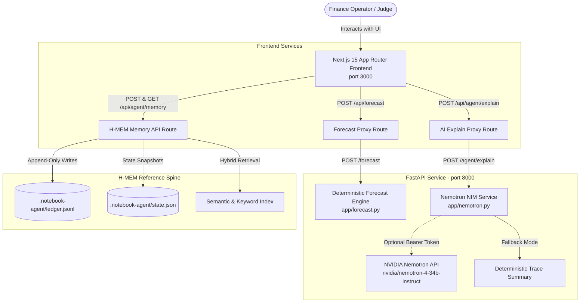

# PaisaPilot AI — Intelligent Cash-Flow Engine & Memory Agent

> **Deterministic cash-flow forecasting, guardrailed AI risk explanation, and persistent institutional memory for small businesses and finance operators.**

PaisaPilot AI solves a critical problem faced by small businesses, startups, and operational finance teams: **unpredictable cash-flow volatility and reserve breaches**. When unexpected expenses or delayed receivables collide, businesses risk overdrafts or missed obligations. 

Unlike traditional LLM "financial advisors" that hallucinate numbers or generic spreadsheet formulas that lack memory, PaisaPilot AI pairs a **100% deterministic calculation engine** (FastAPI) with a **guardrailed AI explanation agent** (NVIDIA Nemotron NIM) and an **isolated hierarchical memory spine** (H-MEM).

---

## Architecture Overview



---

## Core Capabilities

### 1. Deterministic Cash-Flow Forecasting & Reserve Breaches
- **Multi-Horizon Daily Projections**: Calculates exact daily ending cash balances across 7-day, 14-day, and 30-day horizons.
- **Conservative Income Ingestion**: Automatically includes `confirmed` and `scheduled` cash inflows while excluding `uncertain` items by default to prevent optimistic cash traps.
- **Same-Day Settlement Ordering**: Prioritizes outgoing expenses before incoming revenues on identical dates, reflecting realistic end-of-day bank processing order.
- **Automated Reserve Breach Detection**: Identifies the exact date a projected balance dips below the operator's specified reserve target, computing the minimum balance and the maximum `reserve_gap`.

### 2. What-If Scenario Modeling
- Simulate liquidity impacts before committing capital.
- Toggle uncertain income inclusion on the fly.
- Adjust reserve threshold requirements.
- Simulate expense deferrals: move invoice due dates forward by $N$ days to evaluate breach elimination.

### 3. Guardrailed AI Evidence Explanations
- Integrated with NVIDIA Nemotron (`nvidia/nemotron-4-34b-instruct`) via an OpenAI-compatible NIM interface.
- **Strict Guardrail Prompting**: The model is restricted to interpreting calculated JSON figures—it is mathematically constrained never to recalculate, modify, or invent financial figures.
- **Deterministic Fallback**: If `NEMOTRON_API_KEY` is not configured, or if the API is offline, the backend automatically generates a comprehensive deterministic trace summary without failing. Zero API keys are required to run the demo.

### 4. Persistent H-MEM Investigation Memory
- Grounded in the Meterless Hierarchical Memory (H-MEM) reference engine.
- **Audit Logging**: Commit investigation notes into an append-only verifiable ledger (`.notebook-agent/ledger.jsonl`).
- **Privacy Allowlist Guardrails**: Enforces a 500-character cap and regex filtering to reject sensitive bank balances, specific dollar amounts, passwords, and API keys (`/balance/i`, `/api_key/i`, `/password/i`, `/secret/i`, `/credit_card/i`, `/\$\d/`).
- **Hybrid Retrieval**: Search past decisions and notes using semantic cosine similarity, keyword Jaccard overlap, recency decay, and provenance confidence tracking.

---

## Technology Stack

- **Frontend**: Next.js 15.5 (App Router), React 19, Tailwind CSS v4, Recharts, Lucide React Icons.
- **Package Manager & Runtime**: Bun 1.4 / Node.js 22.
- **Backend Service**: Python 3.11+ / FastAPI, Uvicorn, Pydantic v2 (Strict Decimal validation).
- **AI Service**: NVIDIA Nemotron-4-34B-Instruct via NVIDIA NIM (with deterministic fallback).
- **Memory Spine**: H-MEM reference TypeScript engine in `vendor/hmem/` with local persistence.

---

## Prerequisites

- **Node.js** (v20+ or v22 LTS) or **Bun** (v1.2+)
- **Python** (v3.11+)

---

## Quick Start & Local Setup

### 1. Clone & Install Dependencies

```bash
# Clone the repository
git clone https://github.com/Shuzaifa12/PaisaPilot_AI.git
cd PaisaPilot_AI

# Install root dependencies
bun install
# (or npm install)

# Install frontend dependencies
bun install --cwd frontend
# (or npm install --prefix frontend)
```

### 2. Configure Environment Variables (Optional)

PaisaPilot AI runs fully out-of-the-box with zero keys required. If you wish to configure custom endpoints or enable live NVIDIA Nemotron API calls:

```bash
# Copy backend environment template
cp backend/.env.example backend/.env

# (Optional) Edit backend/.env to provide your NVIDIA API key:
# NEMOTRON_API_KEY=nvapi-...
```

---

## Running the Application

To run the complete system, start the backend and frontend in two separate terminals:

### Terminal 1: Python FastAPI Backend (Port 8000)

**On macOS / Linux:**
```bash
cd backend
python3 -m venv .venv
source .venv/bin/activate
pip install -r requirements.txt
uvicorn app.main:app --host 127.0.0.1 --port 8000 --reload
```

**On Windows (PowerShell):**
```powershell
cd backend
python -m venv .venv
.\.venv\Scripts\Activate.ps1
pip install -r requirements.txt
uvicorn app.main:app --host 127.0.0.1 --port 8000 --reload
```

Verify backend health: [http://127.0.0.1:8000/health](http://127.0.0.1:8000/health) (or interactive API docs at [http://127.0.0.1:8000/docs](http://127.0.0.1:8000/docs)).

### Terminal 2: Next.js Frontend (Port 3000)

From the project root:
```bash
bun run dev
# (or: npm run dev)
```

Open your browser to: **[http://localhost:3000](http://localhost:3000)**

---

## Running Automated Tests

PaisaPilot AI includes comprehensive test coverage across both the TypeScript memory engine and the Python deterministic backend:

### 1. H-MEM Reference Engine Tests (TypeScript)
```bash
bun test vendor/hmem/test/smoke.test.ts
# Runs 10 tests: scoring, feedback deltas, dreaming, append-only ledger, and conflict resolution.
```

### 2. Frontend Lint & Production Build
```bash
bun run lint
NODE_ENV=production bun run --cwd frontend next build --turbopack
```

### 3. FastAPI Backend Tests (Python)
```bash
cd backend
source .venv/bin/activate       # On Windows: .venv\Scripts\Activate.ps1
pytest tests
# Runs 10 tests: forecast math, schema validation, same-day rule, and Nemotron fallback.
```

---

## Guided Demo Walkthrough for Judges

1. **Open the Dashboard**: Visit [http://localhost:3000](http://localhost:3000). The sidebar indicates `FastAPI Connected` with a green indicator.
2. **Load Demo Inputs**: Click the **"Load Demo Inputs"** button in the header.
3. **Execute Baseline Forecast**: On the Overview or Cash Flow tab, click **"Run Deterministic Forecast"**. 
   - Observe the live KPI stat cards update (Current Balance, Projected Balance, Reserve Gap, and Reserve Breach Date).
   - View the daily trajectory line chart in relation to the red dashed reserve target.
   - Read the AI Explanation (rendered via Nemotron NIM or deterministic fallback) and transaction inclusion audit.
4. **Inspect Risk Alerts**: Switch to the **Risk Alerts** tab to see reserve breach warnings and uncertain income isolation.
5. **Simulate a What-If Scenario**: Switch to the **Scenarios** tab. Select the Rent expense (`exp-1`) and set **"Days to Defer"** to `7`. Click **"Run Scenario Forecast"** to see how postponing rent resolves the projected cash deficit.
6. **Commit & Search Memory**:
   - Scroll to **"Investigation Notes & Memory"** on the Overview tab.
   - Type an investigation note (e.g., *"Confirmed client retainer arriving next week; deferring rent eliminates 7-day reserve breach."*). Notice the live 500-character counter.
   - Click **"Save Note to H-MEM"**. The note is written to `.notebook-agent/ledger.jsonl`.
   - Search memories using keywords like `"deterministic"`, `"rent"`, or `"reserve"` to verify real hybrid semantic retrieval.

---

## Important Notice & Limitations

- **Decision-Support Estimates**: All cash-flow projections and horizon balances produced by PaisaPilot AI are deterministic estimates based solely on operator-provided dated entries. They do not constitute financial guarantees or certified accounting audits.
- **No Direct Bank Connections**: This hackathon build operates in a self-contained local environment without direct banking or payment rails.
